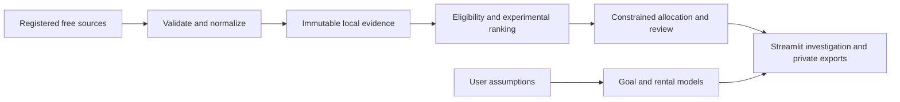

# Investment Research Workbench

A local Python workspace for investigating stock evidence, exploring investment
goals, and underwriting rental-property scenarios. The emphasis is reproducible
calculations, inspectable assumptions, and withholding conclusions when evidence
is missing. This is an actively developed research prototype.

**Stack:** Python 3.11+, Streamlit, FastAPI/Pydantic, SciPy MILP, pandas/Altair,
SQLite for optional trusted-local history, and pytest.

## What you can explore

| Workflow | Implemented | Material limitations |
| --- | --- | --- |
| Stocks | Dated evidence, experimental sector-relative quality/value ranking, constrained baskets, holdings review, monthly-deposit previews, snapshots, change review and PDF export | Verified recommendations remain disabled. Official membership, economic share-class completeness, historical point-in-time coverage and provider rights remain incomplete. |
| Goals and allocation | Contribution planning, scenario/risk analysis, sensitivity, contribution-only integer-cent allocation, private JSON/PDF exports | Assumptions are scenarios, not calibrated forecasts. No brokerage execution. |
| Rentals | Rental/house-hack underwriting, holding-period cash flows, purchase constraints and area-data feasibility work | Complete Orange County rental discovery and matched property-level rent coverage are unfinished. |
| Supporting tools | Deterministic tax estimate, debt payoff comparisons and readiness prompts | Narrow documented assumptions; no personalized tax or investment advice. |

Stocks are being completed before new Orange County discovery work. Both remain
part of the intended product. No guaranteed returns or proven S&P 500
outperformance are claimed.

## Engineering decisions

- **Evidence before conclusions:** missing data is separate from observed rule
  failures. Experimental research never silently becomes a verified recommendation.
- **Reproducible data processing:** immutable hash-checked artifacts, source/model
  provenance, atomic publication, cohort validation and failure preservation.
- **Explicit financial models:** cent-reconciled cash, hard concentration limits,
  inspectable score contributions, matched cost assumptions and no invented inputs.
- **Private by default:** loopback binding, session-only mode, disabled external AI,
  opt-in local persistence and explicit private exports.
- **Test-driven development:** independent reference calculations, invariants,
  failure injection, source-age boundaries, API contracts and Streamlit interactions.



The public repository contains code, synthetic fixtures and small attributed
reference cases. **Provider caches, API credentials, personal inputs, databases
and generated reports are excluded.** Publishing this source is separate from
deploying a financial-data service.

## Run locally

No paid service or API key is required for the calculators, synthetic strategy
examples or test suite. Real-data research requires separately obtained local
evidence and the applicable provider permissions; it starts withheld in a clean clone.

```bash
python -m venv .venv
# Windows PowerShell: .venv\Scripts\Activate.ps1
# macOS/Linux: source .venv/bin/activate
python -m pip install -r requirements-dev.txt
```

Copy `.env.example` to `.env` if configuration is needed. Keep the safe defaults:
`APP_MODE=ephemeral`, `ENABLE_AI=false`, `MARKET_DATA_MODE=withheld`.

Start the API and UI in two terminals with the virtual environment active:

```bash
python run_api.py
```

```bash
streamlit run streamlit_app.py
```

Open the local Streamlit URL printed in the terminal. API documentation is at
[127.0.0.1:8000/docs](http://127.0.0.1:8000/docs). Goal planning, allocation and
the synthetic research workbench can run directly in Streamlit; some supporting
calculators call FastAPI. Imported files are processed by the local server.

For a short walkthrough, see [the synthetic demo](docs/research-demo.md).
Do not enable trusted-local history or external AI on a public multi-user host;
authentication and deployment acceptance are unfinished.

## Validation

```bash
python tools/prepare_public_repository.py
python -m pytest -q
```

Enable `RUN_API_REQUEST_TESTS=1` and `RUN_UI_TESTS=1` for the full integration
suite. GitHub Actions is configured for Python 3.11 and 3.12 with both enabled;
a remote CI result will only exist after this repository is published and run.

The clean-source full regression passed **642 tests**, with UI/API checks enabled,
no `.env` or provider cache, and safe defaults. Final audit-only guards passed
18 focused checks; see [the publication audit](docs/publication-readiness.md)
for scope, versions and remaining installation/CI limitations. Tests do not
establish investment performance, visual accessibility or beginner understanding.

## Research evaluation and next work

The installed-data workflow passed ten bounded software checks after a tested
UTC/local-date correction. That dated result is not a permanent freshness claim.
One-company yield sensitivity, transparent selection baselines and entry-cost
illustrations evaluate behavior rather than strategy returns. Historical strategy
testing remains withheld without contemporaneous membership, filings, valuations
and removed-security coverage. Prospective paper follow-up needs later observations.

Remaining work includes stock acceptance and observed beginner tasks, rental
discovery/coverage, cross-domain comparisons and a separately isolated public demo.
See the [roadmap](docs/PROJECT_ROADMAP.md),
[decision pipeline](docs/DECISION_WORKFLOW_PIPELINE.md), and
[retained implementation history](docs/development-history.md).

## Data, security and reuse

- [Data boundaries and attribution](docs/DATA_RIGHTS.md)
- [Privacy boundaries](docs/privacy-boundaries.md)
- [Security policy](SECURITY.md)
- [Contributing](CONTRIBUTING.md)
- [Public upload instructions](docs/public-upload.md)

No general reuse license has been selected. Public visibility is not a grant
of an open-source license; third-party data retains its own terms. The application
is educational research software, not investment, legal or tax advice.
