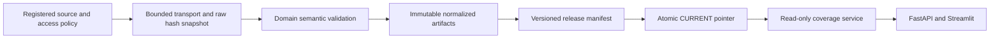

# Public data verification and ingestion

Updated October 28, 2026. This milestone strengthens data engineering and exposes
actual coverage. It does **not** complete verified live discovery in either domain.

## Measured scope

The normalized release contains **35,544 records across ten datasets**. Most
records are historical area-index observations, not securities or properties.

| Evidence | Actual coverage | Supported use | Remaining gate |
| --- | --- | --- | --- |
| Census relationship file | 92 2020 ZCTAs with positive Orange County land overlap; 8 shared with other counties; 88 have Orange County as their largest land county | Dated geographic candidate set | Current USPS/residential-address membership and ZIP/ZCTA correspondence |
| Single-family ZHVI | 89 candidate value series, 28,216 observations; latest September 30, 2026 | Area value context | Individual property valuation and display review |
| Mixed-home ZORI | 81 series, 6,486 observations; latest September 30, 2026 | Separately labeled context | Incompatible with single-family underwriting rent |
| Single-family metro ZORI | Los Angeles metro, 141 observations | Regional context | No ZIP or property rent inference |
| IVV holdings | 505 equity proxy rows, October 26, 2026 | Dated fund holdings audit | Authoritative index membership, issuer/security joins and usage review |
| SEC annual samples | AAPL, MSFT and KO complete under the annual normalizer; JPM incomplete | Coherent annual metric reference cases | Universe-wide coverage, verified joins, live valuation and historical-risk data |
| Adjusted daily provider demo | IBM, 100 observations, June 5–October 27, 2026 | Inspect price/dividend/split schema | Only one security; below the strategy's 756-observation requirement; no benchmark |
| HUD FY2027 SAFMR workbook | No verified rows; HTTP 202, empty response on this machine | None yet | Obtain and validate official workbook; benchmarks still differ from achievable single-family rent |
| SEC ticker/exchange mapping | Earlier HTTP 403; new requests require configured operator contact | No verified mapping yet | Configure contact, then obtain and validate mapping; access is not assumed |

The local audit export contains 92 per-area rows, 505 per-security proxy rows,
four issuer sample summaries with missing metric states, and per-source policy,
date and checksum references. Absent metrics remain missing/unjoined rather than
favorable zeroes. A provider county label outside the Census set is reported
separately instead of inflating coverage. Geography has a vintage, not a fabricated
January 1 observation date.

## Architecture and guarantees



- `market_sources.py` fixes allowed URLs and source roles. No user URL downloader.
- `market_data.py` bounds requests and bytes, blocks cross-host redirects, validates
  format, and accepts a semantic validator before promoting a new raw snapshot.
  JSON/workbook sources have a 25 MiB transport limit; large housing CSVs retain
  the 200 MiB ceiling. Duplicate JSON keys and non-finite constants are rejected.
- `source_adapters.py` separates geography, housing categories, holdings proxies,
  current issuer mapping, coherent annual financial samples, and daily adjusted
  price normalization. Invalid OHLC, fractional volume, nonpositive split factors,
  negative dividends, mismatched issuers, duplicate geography and future/invalid
  periods do not silently pass. Future housing observations are excluded/countable.
- `source_policy.py` records research refresh cadences, observation-age policies,
  documentation and unresolved public-display review. Cadences are application
  policies, not provider SLAs. Retrieval age and observation age remain distinct.
- `public_data_store.py` supplies OS-released writer locks, hash verification,
  strict JSON and temporary-file/fsync/replace writes. This protects against
  interrupted processes; it is not a guarantee against every storage/power failure.
- `data_pipeline.py` publishes one validated manifest through an atomic pointer.
  Readers see a complete old or new release. Raw corruption/refresh failure can
  retain a verified normalized artifact with explicit failure/recovery status.
  Partial source refresh preserves the other domain's tables. Offline rebuilding
  identical inputs is idempotent. Corrupt manifests/artifacts fail closed.
- `market_catalog.py` serves typed coverage metadata without provider quote values
  or financial inputs. `GET /research/data-readiness` never downloads data.
- `coverage_report.py` exports local public-source audit matrices. These are distinct
  from private user plans, and do not grant redistribution rights.

Provider request locks serialize cooperating processes sharing one cache. SEC
requests are spaced by at least one second; other registered providers by half a
second. This does not coordinate unrelated hosts/accounts. Retries are bounded
and honor short numeric/HTTP-date Retry-After values. Delays exceeding the
60-second retry budget stop the refresh rather than retrying early. HTTP 403
and empty/non-200 source responses are not bypassed or promoted.

## Run and recover

```powershell
# Reproduce from cached snapshots, without network or credentials.
.venv\Scripts\python.exe tools/refresh_market_data.py --as-of 2026-10-28 --coverage-report output/audits/source-coverage-matrices-2026-10-28.json

# Fetch only missing/due sources; retains visible failures and last-known-good data.
.venv\Scripts\python.exe tools/refresh_market_data.py --as-of 2026-10-28 --download

# Explicit single-source refresh; other published tables remain intact.
.venv\Scripts\python.exe tools/refresh_market_data.py --as-of 2026-10-28 --download --force-refresh --source alphavantage_ibm_daily_demo
```

Defaults: ignored raw `data_cache/`, normalized store `data_cache/published/`.
`MARKET_DATA_STORE` configures the serving path; use CLI `--store` to match a custom
location. A clean checkout runs the synthetic/manual learning tools without data
or credentials and discloses an absent research release. An offline pipeline build
requires cached public snapshots; tests construct independent synthetic fixtures.

New SEC downloads require `SEC_USER_AGENT` with an identifying application name
and operator email in the shell environment or `.env`. No contact is invented,
logged or stored in source artifacts. Cached SEC normalization works without it.
No provider account, API subscription or recurring system task was created.

The CLI records a structured `last_attempt.json`, source failures, counts, elapsed
time and release ID. Earlier immutable releases remain available. To recover,
inspect the recorded failure, repair source access/schema or restore trusted cache
data, then rebuild. Never disable checksum checks to restore availability. A bad
CURRENT pointer must be repaired from a previously verified release by an operator.
Use a separate store for historical as-of investigations rather than moving a
current serving store backward. Provider snapshots can contain revised history;
filtering dates does not recreate point-in-time data.

## Source access and display findings

- [SEC API documentation](https://www.sec.gov/search-filings/edgar-application-programming-interfaces)
  describes free unauthenticated disclosure APIs. [Access guidance](https://www.sec.gov/search-filings/edgar-search-assistance/accessing-edgar-data)
  requests declared identification and rate moderation. This supplies filings,
  not verified S&P membership or a stock price feed.
- [Zillow Research](https://www.zillow.com/research/data/) describes the categories
  and research downloads. [Zillow terms](https://www.zillow.com/corporate/terms-of-use/)
  distinguish permitted aggregate derivative displays with attribution from other
  data uses. The applicable scope of these exact Research CSVs is still unresolved;
  raw rental/value data is not enabled for public display by this milestone.
- [HUD SAFMR](https://www.huduser.gov/portal/datasets/fmr/smallarea/index.html)
  describes ZIP-level program benchmarks and links the FY2027 workbook. The local
  failed download is not evidence of verified rows or achievable property rent.
- [Alpha Vantage adjusted-daily documentation](https://www.alphavantage.co/documentation/)
  provides the public IBM demo. Its [terms](https://www.alphavantage.co/terms_of_service/)
  distinguish personal research from broader uses; public product permission is
  unresolved. Adjusted close, dividends and split factors are retained separately;
  any future adjusted-return calculation must not add dividends again.
- [iShares IVV](https://www.ishares.com/us/products/239726/ishares-core-sp-500-etf)
  provides fund holdings. [S&P's index page](https://www.spglobal.com/spdji/en/indices/equity/sp-500/)
  does not furnish a verified full constituent dataset in the inspected response.
  Neither factsheet text nor matching tickers establishes a licensed complete
  index-membership history or verified security joins.

These are documented application decisions, not blanket legal clearance.

## Interface and remaining gates

The collapsed **Data coverage and sources** panel has Coverage, Sources and dates,
and What this means tabs. It explains missing/incompatible data and separates
observation dates from retrieval dates. The public metadata cache lasts at most
30 seconds; budgets, holdings, uploaded plans and comparisons never enter it.
Manual rental controls and the synthetic stock lab remain usable independently.

Data verification is **partial**. Remaining gates: dated stock membership and
security/issuer mapping, approved broader price/dividend/benchmark and financial
coverage, current ZIP/address mapping, suitable single-family rent evidence, and
source display decisions. Scheduled deployment refresh, multi-host coordination,
production recovery/monitoring and load verification belong to the release phase.
Do not call either discovery workflow ready merely because ingestion succeeds.

## Verification snapshot

Full local suite with HTTP/UI flags enabled: **262 passed, 0 skipped**, exit 0,
27.53 seconds; two dependency deprecation warnings. It covers semantic validation,
raw corruption, interrupted pointer publication, last-known-good fallback,
cross-domain selective refresh, idempotence, concurrent cache misses, OS lock
contention, retry bounds, stale/missing data, export scope and offline API/UI
behavior. This is not production concurrency or an investment-performance result.

Final source release: `ae4f10eb052edaaeac9d61752a1a5d0fbc99da463e8e4d186d57b61aaa26f32c`.
Repeated offline builds reproduced that ID. Manual offline build runs took about
2.5–10 seconds locally; one integrity-checked catalogue read took 0.352 seconds.
No provider network is used when serving. The live local metadata endpoint
returned HTTP 200 against that release. The historical intermittent Windows
native diagnostic did not recur in this full run; its root cause is still an
unresolved release concern. Remote CI remains unconfirmed without a Git remote.

Preview: UI port 8509, matching API port 8008, preserving earlier previews.

Final UI checks: the source table uses readable dataset labels and compact UTC
dates, with exact metadata retained behind a disclosure. Coverage/source/meaning
tabs work in both domains. A 390px viewport had no document overflow. The rental
coverage chart renders 89 within-age observations and 3 missing/older observations;
browser inspection confirmed visible bar heights after correcting compact sizing.
Final focused checks passed (23 pipeline/panel checks and 3 API/workspace checks).
